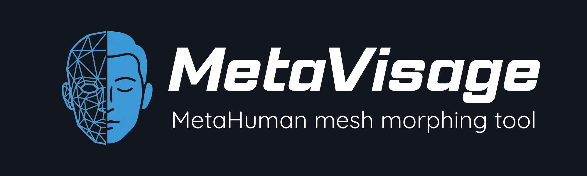

MetaVisage is an open-source Windows desktop application for wrapping MetaHuman
head meshes to custom head models for use in Unreal Engine. All implemented
tools run locally without accounts, subscriptions, or usage limits.

## Features

- **Four-stage workflow**: Alignment, Point Reference, Morph, and Touch Up.
- **Wrap Engine**: Quick Wrap and Fantasy Wrap presets, advanced parameter
  controls, and user presets that can be saved, renamed, replaced, and deleted.
- **Sculpting**: Smooth, Grab, Push/Pull, and Inflate brushes, with symmetry,
  masking, and brush previews.
- **Blender-style controls**: MMB orbit, Shift+MMB pan, scroll zoom, numpad
  views, G/R/S transforms, X/Y/Z constraints, and `[` / `]` brush sizing.
- **Mesh I/O**: FBX, OBJ, and GLTF import/export through Assimp. FBX is the
  default export format; triangulation is off by default to preserve quads.
- **Mesh preservation**: The morph workflow preserves topology, vertex order,
  UVs, normals, and material slots for MetaHuman workflows.
- **Local projects**: Save/load `.mmproj` files, undo/redo, and compatibility
  with v1.0.0 project files.
- **Texture tools**: Six texture slots and local texture baking.

## Requirements

- Windows 10/11 (64-bit).
- GPU and driver supporting **OpenGL 4.3 or newer**.
- 8 GB RAM minimum; 16 GB recommended. Larger meshes require more memory.
- 1920x1080 display recommended.

To build, install Visual Studio 2022 with **Desktop development with C++** and
a Windows SDK, CMake 3.16+, Git, and vcpkg. The application uses C++20, Dear
ImGui, GLFW, GLEW, Eigen, Assimp, nlohmann/json, and Native File Dialog Extended.
Dependencies are listed in [vcpkg.json](vcpkg.json); Qt is not required.

## Build and run

The standalone changes are on `development`. Run these commands in PowerShell;
replace the toolchain path with your vcpkg installation:

```powershell
git clone --branch development https://github.com/cmershon2/MetaVisage.git
cd MetaVisage
.\build-msvc.ps1 -Deploy -VcpkgToolchain "C:/vcpkg/scripts/buildsystems/vcpkg.cmake"
Push-Location build/bin/Release
.\MetaVisage.exe
Pop-Location
```

Keep the executable, runtime DLLs, and staged `assets/` directory together.
See [BUILD.md](BUILD.md) for vcpkg setup, tests, and troubleshooting. MSVC is
the validated toolchain; the retained MinGW helper requires a compatible vcpkg
triplet and has not been validated for the standalone release.

To package a tested Release build, run `.\package-release.ps1`. It creates a
Windows ZIP and SHA-256 checksum under `release/`. See
[release packaging](BUILD.md#package-a-release) for contents and validation.

## Workflow

1. **Alignment**: Load a source MetaHuman head and your target head, then align
   them with move (`G`), rotate (`R`), and scale (`S`).
2. **Point Reference**: Place corresponding landmarks on both meshes in the
   dual viewports. Use symmetry for matching features.
3. **Morph**: Choose a wrap preset, process the mesh, inspect the result, and
   accept it before continuing.
4. **Touch Up**: Refine the result with sculpting brushes and texture tools.
5. **Export**: Use FBX for the Unreal workflow. Keep triangulation disabled
   when preserving the source quad topology for MetaHuman Conform.

Save frequently with `Ctrl+S`; auto-save and crash recovery are not implemented.
Settings, recent projects, presets, and logs are stored under
`%APPDATA%/MetaVisage`. Projects are saved to the location you choose.

## Repository layout

| Path | Contents |
|------|----------|
| `assets/` | Fonts, icons, shaders, gizmos, brush previews, and a reference head mesh |
| `include/`, `src/` | C++ headers and implementation, organized by subsystem |
| `tests/` | Four CTest smoke targets and project/mesh fixtures |
| `docs/` | Known issues and public documentation assets |
| `.agents/`, `.codex/` | Maintainer context and optional agent tooling |
| `build-msvc.ps1`, `build-mingw.ps1` | Build helpers |

Historical sprint and integration documents under `.agents/context/` describe
earlier work. Current scope is the standalone desktop application; the retired
web, account, and paid-feature specifications do not describe current behavior.

## Contributing and support

See [CONTRIBUTING.md](CONTRIBUTING.md) for development and pull request guidance.
Report bugs through [GitHub Issues](https://github.com/cmershon2/MetaVisage/issues).
See [known issues](docs/KNOWN_ISSUES.md) and [release notes](RELEASE_NOTES.md)
before reporting a problem.

## License and credits

MetaVisage code is licensed under the [MIT License](LICENSE). Third-party code
and assets have their own terms. A reference head is present at
`assets/models/MetaHumanHeadLod0.obj`; its source and redistribution terms still
need to be documented before release packaging.

Created by Casey Mershon. Thanks to Epic Games for MetaHuman Creator and to
the maintainers of Dear ImGui, GLFW, GLEW, Eigen, Assimp, nlohmann/json, Native
File Dialog Extended, stb, Inter, JetBrains Mono, Saira, and Lucide.
